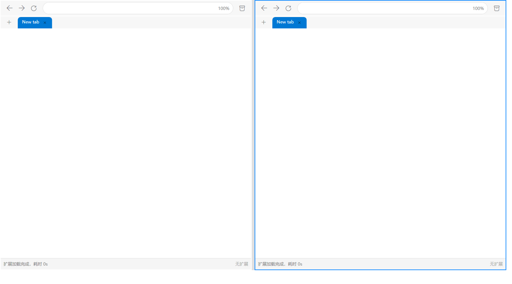
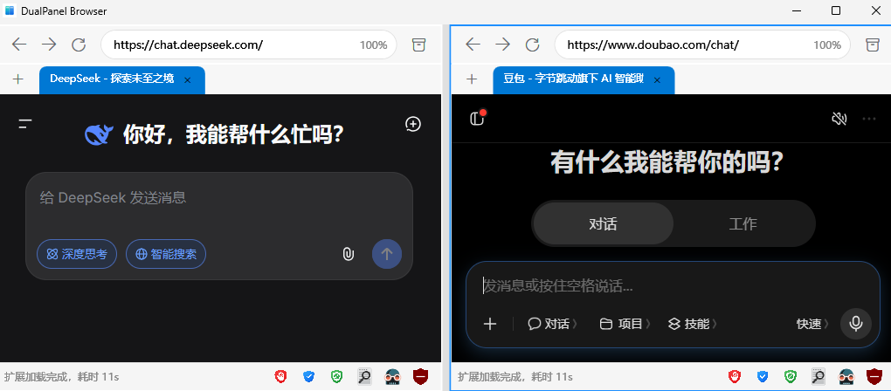

# DualPanelBrowser

基于 **WPF + WebView2** 的 Windows 双面板浏览器：左右分屏浏览、标签页管理、会话恢复、本地广告拦截扩展加载。

## 技术栈

- .NET 8（`net8.0-windows`），WPF + WinForms 互操作
- `Microsoft.Web.WebView2` 1.0.3065.39
- 仅支持 Windows

## 功能

- **左右双面板**：两个独立浏览器面板，拖动中间分隔条调整宽度
- **标签页管理**：每个面板独立标签栏，支持新建、关闭、双击空白处新建；标签可跨面板拖拽且归属跟随当前面板；未选中标签后台预加载
- **标签生命周期**（对齐 GreenBrowser 的部分行为，详见 [docs/route-b-tab-lifecycle.md](docs/route-b-tab-lifecycle.md)）：
  - **后台标签**：网页新链接开出的标签可以不抢焦点、不改地址栏，页面照常在后台加载并完成标题更新
  - **Ctrl+点击**：网页链接按住 Ctrl/⌘ 点击一律后台打开（Chromium 惯例），其余由“新链接在新标签前台打开”设置决定
  - **重复链接去重**：新链接的目标 URL 已有标签时（归一化比较 scheme/host/port/path/query，忽略 fragment），直接切到已有标签而不重复新开
  - **关闭回退**：关闭当前标签后优先回到它的派生来源标签，否则按设置切到左邻 / 右邻 / 末尾，默认左邻
  - **行为设置**：工具栏菜单可切换上述三项，偏好写入 `session.json` 随之恢复
- **会话恢复**：退出时自动保存标签页到 `session.json`，下次启动还原左右两侧标签
- **地址栏**：
  - 已有协议前缀（`http://`、`https://`、`about:`、`chrome-extension://`、`file://`、`data:`）原样访问
  - 命中域名 / IPv4 / localhost（可带端口与路径）自动补 `https://`
  - 其余输入按关键词走 Bing 搜索（`https://www.bing.com/search?q=`，URL 编码）
  - **Ctrl+Enter**：无点的词补成 `www.<词>.com`，有点的补 `www.`，再补 `https://`
  - 地址栏最右侧显示当前页面缩放百分比（切换标签、导航完成、缩放变化时刷新）
- **扩展管理**：加载本地解包扩展目录 / `.crx`，内置扩展管理页面，底部状态栏显示扩展彩色图标
- **焦点与进度**：点击面板高亮蓝色边框，地址栏下方显示加载进度条
- **便携模式**：用户数据、扩展、会话、日志均存放在 exe 同目录，不写系统配置目录

## 标签行为设置

工具栏右侧「菜单」按钮的上下文菜单里：

| 菜单项 | 默认 | 说明 |
|---|---|---|
| 新链接在新标签前台打开 | 勾选 | 不勾选则网页新链接开出的标签在后台，不打断当前页面 |
| 重复链接去重 | 勾选 | 同一 URL 已有标签时切到已有标签，不再新开 |
| 关闭标签后切换到 | 左侧标签 | 可选左侧标签 / 右侧标签 / 最后一个标签；派生来源标签始终优先 |

三项偏好随 `session.json` 持久化，重启后保持。

## 效果图



左右双面板布局：标签栏、地址栏（最右侧为缩放百分比）、底部扩展状态栏；蓝色边框标识当前焦点面板。



左 DeepSeek、右豆包双页面同屏浏览；底部状态栏显示已加载扩展的彩色图标。

## 快捷键

| 快捷键 | 作用 |
|---|---|
| `Ctrl+T` | 在焦点面板新建标签 |
| `Ctrl+W` | 关闭焦点面板当前标签 |
| `Enter`（地址栏） | 导航或发起搜索 |
| `Ctrl+Enter`（地址栏） | 补全 `www.` / `.com` 后访问 |

## 编译环境

本机实测环境（其他 Windows 版本可按需对应调整）：

| 项 | 版本 / 说明 |
|---|---|
| 操作系统 | Windows 11 专业版（10.0.22631） |
| .NET SDK | 10.0.404（目标框架 `net8.0-windows`，可向下构建 .NET 8 目标） |
| .NET Desktop Runtime | 8.0.33（运行所需） |
| WebView2 Runtime | 157.0.4341.x（Edge 内核） |
| WebView2 NuGet 包 | `Microsoft.Web.WebView2` 1.0.3065.39 |
| NuGet 源 | 华为云镜像，见 `nuget.config` |

> 项目目标框架为 `net8.0-windows`，需在 Windows 上编译；WPF / WebView2 均不支持 Linux、macOS。

## 编译命令

```bash
# 还原依赖
dotnet restore

# Release 编译
dotnet build -c Release
```

产物：`bin/Release/net8.0-windows/DualPanelBrowser.exe`。

`extmanager.html` 与 `assets/ext_*.png` 由工程文件在编译时自动复制到输出目录。

## 便携包出包

```powershell
pwsh scripts\pack-portable.ps1
# 可选参数：-Source <Release 输出目录>  -Target <便携包目录>  -CrxSource <crx 来源目录>
```

脚本把 Release 产物、三架构 `runtimes` loader、`assets`、`extmanager.html` 和 4 个内置 `.crx` 复制到便携包目录，并在出包时**自动剥离所有敏感数据**，便携包外带不含任何已保存信息：

| 剥离项 | 对应文件 / 规则 | 原因 |
|---|---|---|
| WebView2 密码库 | `Data/**/Login Data*`、`Login Data For Account*`（含 `-journal`） | 已保存的账号密码 SQLite 库 |
| 主加密密钥 | `Data/**/Local State` | DPAPI 包裹的密钥，配合密码库可解密 |
| 登录 Cookie | `Data/**/Cookies` | 已登录站点的会话凭据 |
| 会话记录 | `session.json` | 上次打开的标签页与行为偏好 |
| 诊断与符号 | `*.log`、`*.dmp`、`*.pdb`、`*.xml` | 调试痕迹与 SDK 文档，不随包发布 |

`Data/` 目录整体清空，WebView2 首次启动时重建空白配置。出包后脚本自动扫描校验，发现残留密码库、密钥、Cookie、会话或调试文件即报错退出。

> 说明：WebView2 密码为 DPAPI 包裹的传统 v10 加密，未启用 Edge 的 App-Bound 加密；便携包不保留密码库，是当前成本最低、风险最小的防护方式。壳内不提供密码查看/管理入口。

## 目录结构

```
DualPanelBrowser-dev/
├── DualPanelBrowser.csproj   # 工程文件
├── nuget.config              # NuGet 镜像配置
├── README.md
├── .gitignore
├── scripts/
│   └── pack-portable.ps1     # 便携包出包：复制产物并剥离密码库/密钥/Cookie/会话
├── src/                      # 源码
│   ├── App.xaml              # 应用入口
│   ├── MainWindow.xaml(.cs)  # 主窗口（双面板布局、会话保存/还原、全局快捷键）
│   ├── BrowserPane.xaml(.cs) # 单侧面板（工具栏、标签栏、地址栏、缩放显示）
│   ├── ExtensionManager.cs    # 扩展解包与加载
│   ├── ExtPopupWindow.cs      # 扩展 popup 弹窗
│   ├── ExtensionsWindow.xaml(.cs) # 旧版扩展弹窗
│   └── extmanager.html       # 扩展管理页面（内嵌 HTML）
└── assets/                   # 图标资源
    ├── app.ico
    ├── ext_adblockplus.png
    ├── ext_adblockultimate.png
    ├── ext_adguard.png
    ├── ext_ublock.png
    └── icon-source.png
```

## 运行时文件（exe 同目录，不纳入版本库）

| 路径 | 说明 |
|---|---|
| `Data/` | WebView2 用户数据目录 |
| `Extensions/` | 解包后的扩展目录及 `load.log` 加载日志 |
| `session.json` | 上次会话标签页记录（含标签行为偏好三项） |
| `extdebug.log` | 诊断日志（地址解析、扩展加载等打点） |

## 已知限制

- 仅 Windows：WPF 与 WebView2 均为 Windows 专用，无 Linux/macOS 嵌入层
- 扩展为本地解包加载，不接入 Chrome 网上应用店；第三方扩展 API 兼容性以实测为准
- 页面加载失败只显示 WebView2 内置错误页，不做失败态标记或自动重试（Chromium 仅在连接级错误上自带重试）
